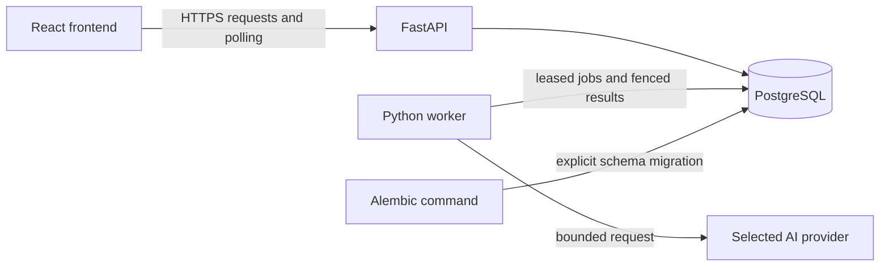

# Architecture

Frontend and backend are independent runtime roots. API and worker compose the same typed Python package. This repository has no runtime dependency on the other portfolio application.

## Frontend

| Path                         | Responsibility                                                                                                                |
| ---------------------------- | ----------------------------------------------------------------------------------------------------------------------------- |
| `src/App.tsx`                | Query client provider and router composition.                                                                                 |
| `src/router`                 | Stable data router, typed auth/main route groups, path constants, lazy page loading and protected workspace/session boundary. |
| `src/pages/<name>/index.tsx` | Page composition. Unique components and orchestration live beside the page.                                                   |
| `src/components/<domain>`    | Reusable or potentially reusable components and domain UI behavior.                                                           |
| `src/components/ui`          | Official shadcn components and named public exports.                                                                          |
| `src/api`                    | Generated client, runtime contracts, authenticated transport, explicit browser fixtures and offline snapshots.                |
| `src/api/feedback`           | Feedback queries and mutations, including infinite loading and analysis actions.                                              |
| `src/hooks`                  | Shared authentication, connectivity and generic UI hooks.                                                                     |
| `tests`                      | Tests mirroring their production owners.                                                                                      |

The router uses `createBrowserRouter` and `RouterProvider`. `routes-auth.tsx` and `routes-main.tsx` describe `RouteObject[]` groups; `paths.ts` owns paths. Pages load lazily with explicit loading and error boundaries. The router is created once, not on each render.

Pages are `/login`, `/register`, `/feedback`, `/feedback/:id` and `/activity`. Page implementations use `pages/<name>/index.tsx`. Auth's form and submission hook are adjacent; Activity's disclosure card is adjacent. `components/feedback` exports `Feed`, `Filter` and `Summary` without repeating the directory name in every component.

Public aliases have at most two segments after `@/`, for example `@/components/feedback`, `@/components/ui` or `@/api/feedback`. Public barrels use named exports; siblings use relative imports. Generated client and upstream shadcn internals retain their supported conventions. UI uses Nova / Neutral / Blue / chartBlue / Inter / Lucide with semantic tokens.

The client is generated with pinned `swagger-typescript-api` from the actual FastAPI OpenAPI document. Application code validates external responses and coordinates sessions; generated types alone do not validate runtime data. Server state uses TanStack Query, shareable filters live in the URL, and saved snapshots are bound to their workspace. A stale session cannot submit selected analysis into the next session. Browser fixtures are explicit and never replace a failed connected API.

The production build embeds the complete list of public assets into the service worker, including lazy page chunks. The asset-list hash changes its cache identity on a new build. Only public application resources are cached there; API responses and mutations are excluded. Explicitly saved feedback remains workspace-scoped application storage.

## Backend

| Path             | Responsibility                                                                                                |
| ---------------- | ------------------------------------------------------------------------------------------------------------- |
| `models`         | Typed SQLAlchemy declarative entities, grouped by domain, with shared `Base.metadata`.                        |
| `schemas`        | Pydantic request, response and provider boundary contracts.                                                   |
| `routers`        | HTTP input, authentication dependencies and response composition.                                             |
| `logic`          | Application rules and transaction coordination for feedback, analysis and pagination.                         |
| `repositories`   | Concrete model queries and persistence operations; ordinary typed functions, no generic repository framework. |
| `infrastructure` | Engine/session lifecycle, signed token codec, provider transport and queue publication.                       |
| `workers`        | Shared job execution, local polling loop and private Vercel queue subscribers.                                |
| `migrations`     | Frozen Alembic schema revisions and explicitly validated adoption.                                            |
| `tests`          | Units, HTTP, PostgreSQL, migrations and worker regressions.                                                   |

`session_scope(engine)` creates an `AsyncSession` and transaction for one operation. Successful exits commit; failures roll back; closing a session releases its resources. ORM entities remain readable after commit. Concurrent operations never share a session. Repositories return typed model objects or explicit response schemas instead of passing generic SQL row dictionaries between layers. Set-based updates remain where an atomic counter, lease, cancellation or bounded cleanup requires them.

Ingestion saves immutable feedback and its job in one transaction. Worker claims use expiring leases and a fence; provider calls happen outside transactions. Completion checks the lease and fence before accepting a result. Explicit analysis retains earlier runs. Backfill freezes its selected membership. These guarantees are tested against real PostgreSQL; no exactly-once external-call or billing guarantee is claimed.

The Vercel migration candidate replaces continuous hosted polling with post-commit queue publication. Private subscribers invoke the same job execution boundary. PostgreSQL remains the pending-work ledger; scheduled recovery repairs missed publications and expired leases. The local Docker worker remains available. See [Vercel deployment](vercel.md) for delivery semantics, idle-cost assumptions and the cutover checklist.

## Pagination

`infrastructure/pagination.py` only encodes, decodes and authenticates the opaque token. `logic/pagination.py` creates frozen views and validates workspace, scope and expiry when resuming one. Feed and run details then apply sequence bounds; Activity applies its own ordinal bounds. A valid signature does not authorize a position outside the saved view.

The feed freezes membership and filters; processing status can still refresh. Activity's read model combines individual jobs and grouped analyses. It returns the exact job/result pair for each item, while record details retain a separately bounded recent history. Existing signed tokens keep their wire format.

## AI analysis

`logic/prompts.py` builds the analysis instructions and schema from shared domain constraints. `FeedbackGenerator` prepares the request through the small model-client contract. The explicit OpenRouter and DeepSeek adapters construct their provider-specific requests and share bounded HTTP transport and response-envelope validation. `workers/providers.py` composes only the selected live model with the worker. `logic/enrichment.py` checks the domain schema and exact source quotes before anything can be saved.

OpenRouter requests strict JSON Schema. DeepSeek Chat Completions uses JSON-object mode with thinking disabled and includes the schema in the system instructions; application validation remains authoritative. The adapters do not share provider-specific routing or retention flags. Switching providers changes new jobs, never historical results or an existing job's provider identity. A queued job for an unconfigured provider fails explicitly.

Retries belong to the durable worker. The transport performs one request per admitted attempt; missing live configuration fails explicitly. A live provider never falls back to deterministic generation. Model, deadline, output-token limit and cumulative call policy come from settings. A shared transactional admission lock checks total usage across providers, then increments the selected provider's durable counter. Existing OpenRouter reservations are retained when DeepSeek is selected. Logs include safe timing and usage metadata, not source text, provider bodies or credentials.

## Schema and deployment

Alembic is the sole schema owner. API and worker startup create connections and check readiness; they do not create tables or alter columns. The separate migration service runs before them. Existing unversioned databases require explicit, structurally validated adoption; unknown or drifted schemas fail before being stamped. ORM metadata is checked against the migrated database.

The hosted application uses Vercel for the frontend and an isolated Docker API/worker/PostgreSQL stack. The release ledger identifies the source revision actually serving each runtime. See [setup](setup.md), [operations](operations.md), [workflows](workflows.md) and [limits](limits.md).
