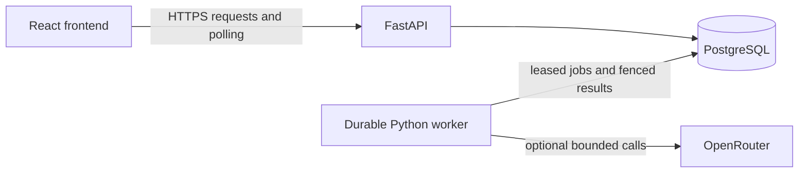

# Architecture

The frontend and backend are independent runtime roots. API and worker compose the same typed Python package. The repository has no runtime dependency on the other portfolio application.

| Path                                              | Responsibility                                                                 |
| ------------------------------------------------- | ------------------------------------------------------------------------------ |
| `frontend/src/pages/<name>/index.tsx`             | Route-level page implementation; unique children are adjacent files.           |
| `frontend/src/components/<domain>`                | Reusable or potentially reusable domain components and named public barrel.    |
| `frontend/src/components/ui`                      | Official shadcn components and the public UI barrel.                           |
| `frontend/src/hooks`                              | Query, auth, filtering and selection behavior.                                 |
| `frontend/src/api`                                | Generated fetch client, runtime contracts, session boundary and demo adapters. |
| `frontend/src/lib`                                | Shared UI utilities.                                                           |
| `frontend/tests`                                  | Frontend units and browser journeys.                                           |
| `backend/src/workbench/routers`, `schemas`        | HTTP composition and typed boundaries.                                         |
| `backend/src/workbench/logic`, `repositories`     | Application operations and transactional persistence.                          |
| `backend/src/workbench/infrastructure`, `workers` | Database/provider adapters and job execution.                                  |
| `backend/tests`                                   | Python, HTTP and real PostgreSQL tests.                                        |

Public imports stop at a named barrel, such as `@/components/feedback` or `@/components/ui`; no more than two path segments follow `@/`. Local siblings use relative imports. Domain context belongs in the directory, so components inside `feedback` are `Feed`, `Filter` and `Summary`. Upstream generated internals retain their supported conventions.

The current local routes are `/login`, `/register`, `/feedback`, `/feedback/:id` and `/activity`. This is a focused first-MVP UI step; it does not rewrite the ORM or replace polling with sockets.

The API client is generated with `swagger-typescript-api` from the application's actual OpenAPI schema. Session coordination, error normalization, runtime validation, offline state and browser fixtures remain explicit application code. Generated TypeScript alone does not validate external data.

Activity has a dedicated read model over individual jobs and bulk groups. Its generated client and runtime contract feed a workspace-scoped TanStack infinite query. Each item hydrates the exact job/result pair; record responses independently retain a small recent-history window. Page-specific disclosure cards remain beside the Activity route.

## Persistence boundaries

Ingestion stores immutable input and its job atomically. Workers use expiring leases and fence completion; provider calls happen outside the database transaction. Backfill freezes a bounded selection and preserves older results. Stable feed views bind cursor membership to workspace and filters. See [workflows](workflows.md) and [limits](limits.md) for concrete guarantees and tradeoffs.

The hosted baseline uses Vercel for the frontend and an isolated Docker API/worker/PostgreSQL stack. The current source reorganization is local and requires a separate reviewed deployment. See [operations](operations.md).
