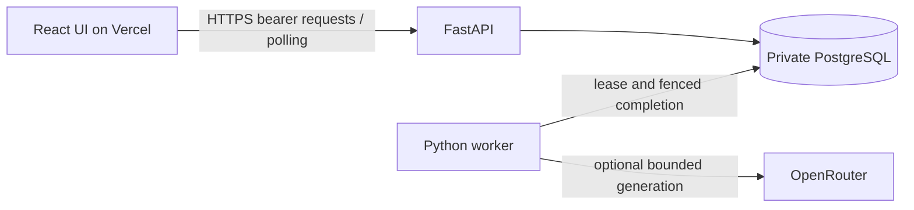

# Architecture

The Python API and worker share one typed application package. HTTP composition is separate from application logic, repositories and provider/database adapters. The independent frontend consumes validated API contracts; there is no cross-repository runtime dependency.

| Path                                        | Responsibility                                             |
| ------------------------------------------- | ---------------------------------------------------------- |
| `web/src/pages`                             | Page composition.                                          |
| `web/src/components`                        | Feature UI, layout and generated primitives.               |
| `web/src/hooks`                             | Query, auth, filtering, paging and selection state.        |
| `web/src/lib`                               | API client, contracts, fixture adapters and utilities.     |
| `backend/src/workbench/routers`             | HTTP routes grouped by concern.                            |
| `backend/src/workbench/schemas`             | Strict request/response/provider models.                   |
| `backend/src/workbench/logic`               | Auth, feed, ingestion, enrichment and backfill operations. |
| `backend/src/workbench/repositories`        | Queries and transactional persistence.                     |
| `backend/src/workbench/infrastructure`      | Database and external provider adapters.                   |
| `backend/src/workbench/workers`             | Claim processing and runner.                               |
| `backend/src/workbench/api.py`, `worker.py` | Thin application entrypoints.                              |
| `tests/backend/src/workbench`               | Mirrored Python tests.                                     |
| `tests/web/src`, `tests/web/src/pages`      | Mirrored frontend tests and browser journeys.              |

Frontend tooling and its lockfile belong to one root pnpm workspace. Frontend tooling and its lockfile belong to one root pnpm workspace. Frontend tooling and its lockfile belong to one root pnpm workspace. The `web/` and `backend/` runtime roots are deliberate: a separate package for every layer would add overhead without a second Python distribution consumer. Test ownership is centralized under root `tests/`. Local refactor verification passed; hosted release status is tracked in [status](delivery-status.md).

## Data and durability

A transaction inserts immutable input and its job together. A unique input identity provides idempotent insertion; changed content under the same identity conflicts. Immutable result versions are keyed by record/configuration. Backfill freezes a bounded selection and atomically creates its persisted work.

Workers claim expiring leases under a global concurrency bound, call the provider outside the transaction and fence completion. A database advisory lock serializes selected demo mutations/view creation, trading throughput for understandable bounded consistency. This is not a throughput benchmark.

Feed views freeze matched IDs while processing and arrivals continue. Each page uses a descending sequence keyset and SQL limit, then hydrates only that page. Signed cursors bind workspace, filters and view; views have retention limits. Status polling updates visible results without silently changing list membership.

See [hosting decision](decisions/0002-hybrid-hosting.md), [workflows](workflows.md) and [limits](limits.md).
