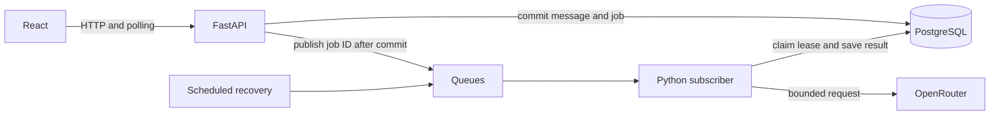

# Architecture

Local Docker uses the same processing logic through a polling worker. Hosted processing uses private queue subscribers. PostgreSQL remains the source of truth in both environments.

## Repository boundaries

- `frontend/src/pages/<page>/index.tsx`: routed pages; unique page components stay beside their page.
- `frontend/src/components/<domain>/`: reusable components with public `index.ts` exports.
- `frontend/src/api/`: generated client, validation and session handling. Browser-only fixtures are grouped in `api/demo/`.
- `backend/modules/api/routers/`: HTTP parsing, dependencies and response schemas.
- `backend/common/schemas/`: validated boundary models.
- `backend/common/logic/`: application operations, independent of HTTP handlers.
- `backend/common/repositories/`: typed SQLAlchemy queries and transactional persistence.
- `backend/common/infrastructure/`: database, HTTP and queue adapters.
- `backend/modules/worker/`: job admission, execution and completion.
- Each runtime owns a `tests/` directory that mirrors its source structure. Alembic migrations live in `backend/migrations/`.

`modules/api` owns HTTP and Swagger; `modules/worker` owns polling and Queue entrypoints. `common` contains their shared application code. A repository function reads or writes data through the supplied session; it does not own HTTP behavior or decide product policy. Logic composes those queries through an ORM `Session` and typed `Query` objects. API and worker boundaries call `run_transaction`, which commits or rolls back one operation. SQLAlchemy’s `AsyncSession.run_sync` adapts those ORM calls to asyncpg, so database I/O yields without threading a session across requests. Concurrent operations use separate sessions.

## From feedback to analysis

1. Authenticate the workspace and validate the input and request identity.
2. Save the immutable message and its job in one transaction.
3. After commit, publish the job ID. Publication failure leaves durable pending work for retry or scheduled repair.
4. Claim an expiring lease and reserve a provider attempt. Call OpenRouter outside the database transaction.
5. Validate the structured result and exact source quotes, then save it only if the lease and completion fence still match.

A repeated delivery cannot overwrite a completed result. It can repeat an external call after an uncertain failure, so storage idempotency is not an exactly-once billing guarantee. Cancellation prevents a stale completion from being accepted; it cannot undo a call already sent.

OpenRouter is the only AI provider. Its adapter requests strict JSON Schema and bounded output. The worker owns retries; the HTTP transport makes one request per admitted attempt. Failed live calls never fall back to prepared samples.

## Review and history

Feedback details show the source beside the latest result. Reanalysis creates another run; Activity retrieves the result for that exact historical run. Grouped analysis freezes its selected messages before processing.

Lists use opaque workspace-scoped cursors with `limit`. Saved membership prevents new arrivals from moving records between pages. Refresh explicitly starts a new view. Expired cursors can be reset without losing stored feedback.

Polling pauses after request errors while already loaded data remains visible. The reviewer can retry; an unexpected HTML response or browser security challenge offers a page reload. Offline snapshots are optional, local to the signed-in workspace and cleared on logout.

## Demo data

The demo contains 24 different synthetic messages with context, customer impact and prepared takeaways. Backend fixtures live in `backend/common/fixtures/feedback.json`; the browser-only preview keeps a matching copy in `frontend/src/api/demo/samples.json`. A regression check prevents the two copies from drifting. This keeps both applications self-contained at build time.

Prepared results are visibly labelled. Live analysis is an explicit action and uses the same validated OpenRouter path as submitted feedback.

## Bounds and tradeoffs

| Boundary         | Limit                                                       |
| ---------------- | ----------------------------------------------------------- |
| Input            | 4,000 characters per message                                |
| Workspace        | 500 records; sessions expire after 24 hours                 |
| Grouped analysis | 100 selected records                                        |
| Processing       | Two global leases; 30-second leases; three attempts per job |
| Provider         | 10-second deadline; 800 output tokens by default            |
| Result           | Summary up to 240 characters; one to three exact quotes     |
| Recovery         | Thirty-minute schedule; bounded pages and handler duration  |

The small SQL-backed job ledger avoids adding Kafka or Redis to this MVP. It trades independent queue-state scaling for a simpler transactional boundary. This is not a throughput or high-availability claim. Schema changes are explicit Alembic operations; application startup never changes tables.
